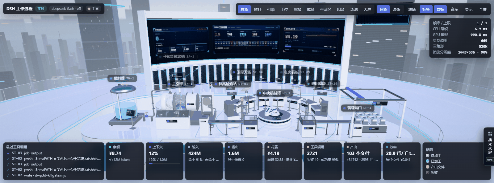
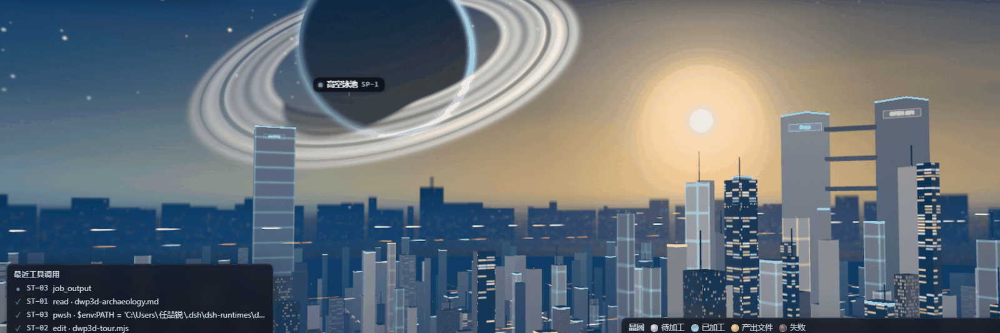
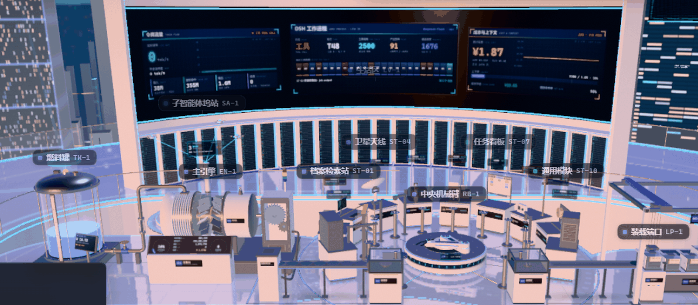
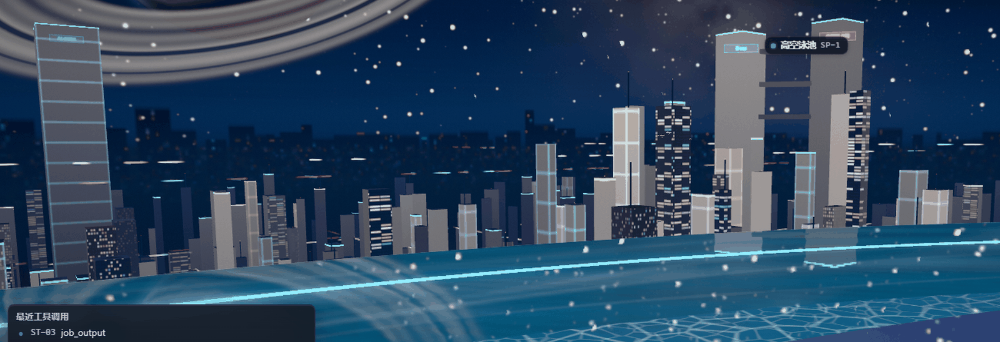
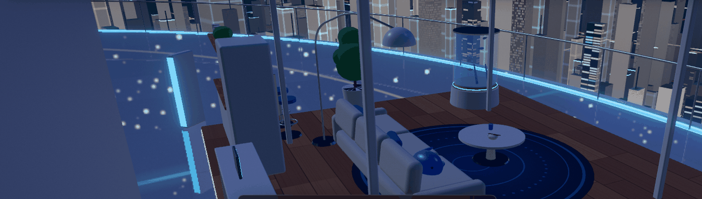

# DSH work process 3D live view

[中文](README.md)

A DeepSeek Harness (DSH) plugin. It adds a "3D process" tab to every conversation and renders the agent's work as a realistic 3D precision factory: tokens are the fuel, tool calls are processed at stations, drones carry out subagent work, and the result of each conversation turn is stored as a batch.

> Version 1.0.0, the first stable release: an open roof, a starry sky with a ringed planet, a Night scene, a sky-high infinity pool on the balcony and background music. The scene runs on the conversation's real data, and a demo mode remains. After installing or updating the plugin, **restart DSH once** so that its Host part (the session projection and the balance lookup) loads.

## Install

- **Plugin market**: search for "3D process" or `dsh-work-process-3d` in the DSH plugin market (dsh-market) and install it there.
- **Manually**: download `dsh-work-process-3d.tgz` from [Releases](https://github.com/YIFUHEYAN-5/dsh-work-process-3d/releases/latest) and add that package in DSH's Plugins panel.
- **From a checkout**: clone the repository and either let a DSH agent install the directory with `plugin_manager` `install_bundle`, or point Plugins > Add plugin at the directory.

Restart DSH after installing or updating. A Client-only change (the page) shows up after a page refresh; a Host change (`src/host/`, `src/model/`) needs the restart.

## Screenshots

The overview with live data: stations, the robot arm, the media wall and the readout strip.



Toward the balcony: the ringed planet, the sunset and the city.



The ten stations and the curved media wall behind them.



The Night look with the infinity pool along the balcony.



The living quarters behind the media wall.



These frames come from a running DSH window; several were captured with software rendering and therefore lack the bloom, live shadows and floor reflections you get on a real GPU.

## What the scene shows

The factory stands on the open roof of a skyscraper about 420 m tall, under open sky, with only a waist-high frameless glass balustrade around the edge. A balcony reaches out toward the sunset, and an infinity pool runs along its outer edge; below lies an open future city, where a distant compute tower feeds the fuel tank through a light beam. A giant ringed planet and a moon hang in the sky, and after dark the stars, the Milky Way and the odd shooting star come out. The scene has three looks: dusk, daylight and night. A curved media wall at the back shows the token flow, a work overview and the cost, and behind it lies a small living area. The machines sit on floating platforms linked by glowing data channels, and the floors are polished close to a mirror.

| Machine | Data |
| --- | --- |
| Fuel tank | DeepSeek account balance (topped-up plus granted) and the tokens it buys at the current model price; a beacon shows peak (full price) or off-peak (half price) hours. While tokens are generated, the compute tower's beam brightens and flows faster |
| Main engine | Rotor speed follows the generation rate; the core color shows the phase (violet thinking and reasoning, blue generating, orange tools) |
| Console | One digital display: a context-pressure dial on the left (orange above 60%, red above 85%), a generation-rate dial on the right, and between them counters for cache-miss input, cache hits, output, reasoning and cost, plus the current phase |
| Wafer dispenser → load lock | Each tool call releases one wafer, which enters the station ring through the load lock |
| Central robot | Moves wafers between the load lock, the stations and the unload lock; it speeds up when work queues. Side light strips and a small panel on its base show the current move, its route and the wafer it carries |
| 10 stations | Archive scanner (read/grep/glob), laser engraver (write/edit), terminal console (pwsh/bash), satellite uplink (web search/fetch), cobot cell (subagents/workflows), hydraulic press (context compression), kanban board (todos/goals), call beacon (questions to the user), labeler (delivered files), generic module (other and MCP tools). A holographic readout above each station shows its status, the current call, the call count and the latest 8 outcomes; when a call finishes, a ring of the station's color spreads over the floor, red if the call failed |
| Subagent dock | Each running subagent or workflow member takes a drone: it picks up a task capsule at the cobot cell and circles the dock; when it finishes it lands, with a green capsule for done, red for failed and grey for stopped. The dock's holographic readout shows running and finished agents and the workflow's progress |
| Unload lock → load port → gantry → stocker | Finished wafers go into the current batch's FOUP; when the turn ends the gantry carries it to the stocker, labeled Pass or Rework |
| Media wall | Three curved screens: token flow, work overview, cost and context. Use Screens in the toolbar or click a screen to look at it up close |
| Living area | A lounge behind the media wall (sofa, sleep pod, kitchen corner, desk and aquarium). It shows no session data |
| Sky pool | An infinity pool on the outer edge of the balcony: the water mirrors the sky and the city and spills over a knife edge into a catch trough, light ripples play on the floor of the basin, and loungers and parasols stand on both sides. It shows no session data |
| Background music | Calm electronic ambient music synthesized live in the page (no audio files). Its key and tempo follow the scene: warm at dusk, bright by day, deep at night. The busier the session, the denser the glass notes, and a soft chime sounds when a turn finishes |

Gold wafers wrote or delivered files; red wafers failed.

## Where the data comes from

- **Live** (default): the plugin's Host part registers the session projection `workProcess3d`, which sums up tokens (including cache hits and cache writes), cost, tool calls, file changes, turns, and the state of subagents and workflows from the session events; the context usage comes from DSH's own context-pressure data. Tokens per second while generating are estimated from the streamed text.
- **Balance**: looked up by the Host part. When you are signed in to your DeepSeek account in DSH it reads the account balance; otherwise it queries `/user/balance` with the DeepSeek API key configured in DSH. The key is only used by the Host on your machine and never reaches the page. The balance refreshes every 2 minutes while the view is visible and after each turn.
- **Demo**: a built-in fictional session (a weather dashboard project) that shows every machine at work. When DSH offers no session projection, or the Host part has not loaded yet (for example right after installing, before a restart), the view switches to demo data and says so at the top left. Display lets you switch between Live and Demo at any time.
- **Prices**: the official deepseek-flash and deepseek-v4-pro prices (CNY per million tokens), with peak prices on weekdays 9–12 and 14–18 Beijing time. Other models are counted in tokens but not priced.

The plugin sends no conversation content to any external service.

## Controls

- Orbit camera mode: drag to orbit, scroll to zoom smoothly toward the cursor, right-drag to pan. When a wall or a machine gets between the camera and its target, the camera moves in and returns once the view is clear.
- Roam camera mode: drag to look around (you can look up at the stars), scroll to move forward and back, right-drag to pan, double-click the floor to walk there. Click the view once, then use WASD or the arrow keys to move; Q goes down, E goes up, and holding Shift moves faster. The balcony is open along its whole width, so you can walk right out to the walkway beside the pool.
- Views at the top right: Overview, Fuel, Engine, Stations, Dock, Products, Living, Balcony and Pool, plus Screens, which faces one of the big screens: scroll to zoom, drag to pan, switch screens with ←/→ or the buttons at the bottom, and press Esc, click beside the screen or use Back to leave. In a narrow tab the views move into a drop-down list.
- Follow makes the camera track the working station, Labels shows machine names, Panels shows the data panels at the bottom, Music turns the background music on or off; Display and Fullscreen complete the toolbar.
- Display holds the data source (live or demo), the scene (dusk, daylight or night), brightness, the music switch and volume, quality (auto/low/medium/high/ultra), the frame rate cap (auto/30/60/120/unlimited), the performance statistics, and a switch that brings dismissed control hints back. Esc closes Display.
- The music is on by default. Browsers play sound only after you have used the page, so when the Music button pulses, click the scene or the button itself and it starts. It fades out and pauses while the tab or window is hidden.
- Hovering a machine or batch highlights it and shows details; in Orbit mode, click a machine to fly to its view.
- Bottom cards: balance, context, input (cache hit rate and uncached tokens), output (with reasoning), cost (peak/off-peak), tool calls, output files (files and changed lines), efficiency (changed lines per 1K output tokens, cost per file). A value glows briefly when it changes; hover a card or select it with Tab for the full explanation.
- Quality is picked from your GPU by default. If the frame rate stays low, the render resolution drops first and then the quality drops one tier for the session. A quality you choose by hand is remembered and never changed automatically. With "reduce motion" set in your system, the interface animations are off, camera flights, Follow and double-click walks jump straight to their target, the stars stop twinkling and no shooting stars appear.

## Requirements

- DeepSeek Harness 0.2.0-rc.1 or later (developed on 0.2.2-rc.3, matching `engines.dsh` in `package.json`).
- A browser or the DSH desktop app with WebGL 2 and hardware acceleration turned on.
- Restart DSH once after installing or updating the plugin.

## Development

```sh
pnpm install
pnpm build   # writes dist/client.js (three.js bundled; React comes from the host) and dist/host.js (zod bundled)
pnpm test    # tests for the model, session projection, balance route, camera, dock, machines, effects and music (no WebGL or sound card)
```

`dist/` is committed with the sources so the plugin can be installed straight from the repository. To try a local copy in DSH, ask the DSH agent to install the repository folder with plugin_manager install_bundle. Client changes show after a page refresh; Host changes (`src/host/`, `src/model/`) need a DSH restart.

Before a release, run `pnpm test` and `pnpm build`, then `pnpm pack`, rename the tarball to the version-less `dsh-work-process-3d.tgz` and attach it to a GitHub Release: the market entry points at `releases/latest/download/dsh-work-process-3d.tgz`, so later releases need no entry change. Never delete or rewrite a published Release or tag, or existing installs break.

### Change workflow

The `main` branch is protected; every change is merged through a pull request:

1. Create a branch from `main`, for example `feat/…`, `fix/…` or `docs/…`.
2. Commit, push the branch and open a pull request. CI runs the tests and the build and checks that the committed `dist/` matches the sources.
3. After the review approves it, squash-merge into `main` and delete the branch.

Layout:

- `index.js`: Host entry; re-exports `dist/host.js`.
- `src/host/`: Host sources: the session projection (zod schemas) and the balance route.
- `src/model/`: renderer-independent model: pricing and peak hours, tool-to-station mapping, the session event reducer (shared by the Host projection and the demo), the projection view trimming, the demo session.
- `src/client/live.js`: live-data helpers for the page: streaming-rate estimate and the balance request.
- `src/client/music.js`: background music synthesized with Web Audio (chord pads, bass, FM glass notes, reverb and delay).
- `src/client/scene/`: the three.js scene, modeled procedurally (no external model or texture files).
- `src/client/view/`: React view and HUD.
- `scripts/build.mjs`: esbuild bundles for the Client module and the Host module.

## Roadmap

1. **M0 style prototype** (done): modeling, materials, lighting, camera and animation.
2. **M1 real data** (done, 0.2.0): a Host session projection with real tokens, context, tool calls, turns, file changes, subagents and workflows; balance from the DeepSeek account or API key.
3. **M2 polish** (done, 1.0.0): the open roof, the starry sky and planet, the night scene, the sky pool, background music, the screen close-up, the living area and a pass over the whole look. Batch replay, a timeline and an input/output report come next.
4. **M3 optional extras**: DeepSeek tool APIs (for example voice announcements), off by default with costs shown.
5. **M4 release** (done, 1.0.0): a GitHub Release and a listing in the DSH plugin market.

## License

[MIT](LICENSE). The bundled three.js and zod are also MIT licensed.
