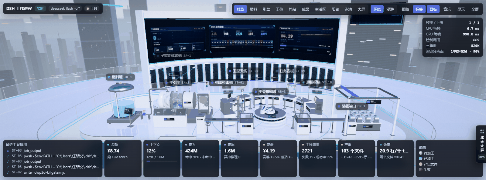
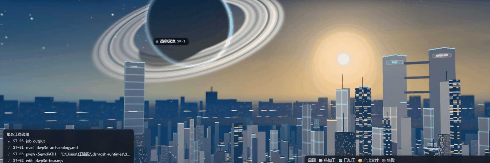
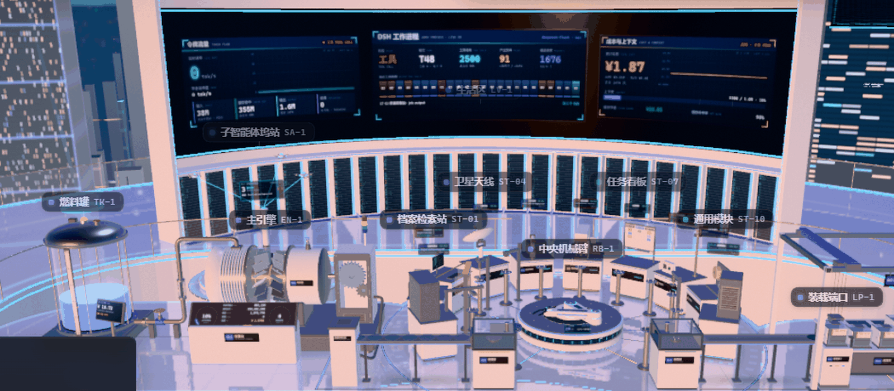
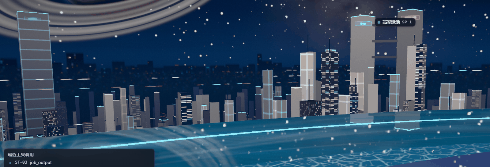
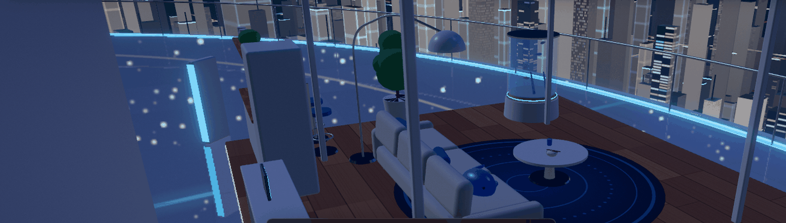

# dsh工作进程3D实时可视化

[English](README.en.md)

DeepSeek Harness（DSH）插件。它在会话视图里新增「3D 工作进程」标签页，把智能体的工作过程渲染成一座写实的 3D 精密工厂：token 是燃料，工具调用在各个工位上加工，子智能体由无人机执行，每一轮对话的成果作为一个批次入库。

> 版本 1.0.0（首个正式版）：露天屋顶、星空与行星、「黑夜」场景、阳台上的高空无边泳池和背景音乐，接入本会话的真实数据，并保留了演示模式。安装或更新插件后需要**重启一次 DSH**，插件的 Host 端（会话投影和余额查询）才会加载。

## 安装

- **插件市场**：在 DSH 插件市场（dsh-market）里搜索「3D 工作进程」或 `dsh-work-process-3d`，一键安装。
- **手动安装**：从 [Releases](https://github.com/YIFUHEYAN-5/dsh-work-process-3d/releases/latest) 下载 `dsh-work-process-3d.tgz`，在 DSH 的「插件」里添加这个包。
- **从源码目录安装**：克隆仓库后，让 DSH 智能体用 plugin_manager 的 install_bundle 安装仓库目录；或把目录路径填进「插件」的添加面板。

安装或更新后重启 DSH。插件只有 Client 端（页面）改动时可以刷新页面生效，Host 端（`src/host/`、`src/model/`）改动必须重启。

## 截图

实时数据下的总览：工位、机械臂、大屏与底部指标条。



阳台方向：带光环的行星、夕阳和城市。



十座工位与背后的弧形大屏墙。



「黑夜」场景与阳台外沿的高空无边泳池。



大屏墙后面的生活区。



以上截图取自本机运行中的 DSH 界面，其中几张是无显卡加速的软件渲染截取的，所以看不到实机上的泛光、实时阴影和地面反射。

## 场景里有什么

工厂建在一座约 420 米高的摩天楼的露天楼顶上，头顶是开阔的天空，四周只有一圈齐腰高的无框玻璃护栏。朝向夕阳的一侧伸出一座阳台，阳台外沿是一座高空无边泳池；脚下是开阔的未来城市，远处的云端算力塔用一道光束给燃料罐供能。天空里有一颗带光环的巨大行星和一轮月亮，入夜后能看到满天星星、银河和偶尔划过的流星。场景有黄昏、白昼和黑夜三种。后方的弧形大屏墙显示 token 流量、工作总览和成本，大屏墙后面是一处生活区。设备立在几座悬浮平台上，平台之间有发光的数据通道，地面抛光到接近镜面，能映出设备和城市灯光。

| 设备 | 对应的数据 |
| --- | --- |
| 燃料罐 | DeepSeek 账户余额（充值余额加赠金），按当前模型价格折算可用 token；指示灯区分高峰（全价）与低谷（半价）时段。生成 token 时，算力塔的光束变亮、流动加快 |
| 主引擎 | 转子转速跟随生成速率；核心颜色表示阶段（紫 思考与推理、蓝 生成、橙 工具） |
| 仪表台 | 一块数字显示屏：左边是上下文压力表盘（超过 60% 变橙，超过 85% 变红），右边是生成速率表盘，中间是未命中输入、缓存命中、输出、推理和花费的计数，以及当前阶段 |
| 晶圆供料器 → 装载锁 | 每次工具调用投放一片晶圆，经装载锁进入工位区 |
| 中央机械臂 | 在装载锁、工位和卸载锁之间搬运晶圆，排队越多动作越快；侧面的灯条和底座上的小屏显示当前动作、路线和手上的晶圆 |
| 10 个工位 | 档案检索站（read/grep/glob）、激光雕刻机（write/edit）、终端控制台（pwsh/bash）、卫星天线（联网搜索/抓取）、协作机械臂（子智能体/工作流）、液压压缩机（上下文压缩）、任务看板（todo/目标）、呼叫信标（向用户提问）、贴标包装机（交付文件）、通用模块（其他与 MCP 工具）。每个工位上方有一块全息屏，显示状态、当前调用、累计次数和最近 8 次结果；调用结束时，工位脚下会扩散一圈工位颜色的光环，失败时为红色 |
| 子智能体坞站 | 每个运行中的子智能体或工作流成员占用一架无人机：先飞到协作机械臂工位取一枚任务胶囊，再绕坞站盘旋；结束后降落，胶囊绿色表示完成、红色表示失败、灰色表示已停止。坞站的全息屏显示运行数、完成数和工作流进度 |
| 卸载锁 → 装载端口 → 天车 → 成品库 | 加工完的晶圆装进当前批次的 FOUP；一轮对话结束后天车把它运到成品库，标签显示「合格」或「返工」 |
| 大屏墙 | 三块弧形大屏：token 流量、工作总览、成本与上下文。点工具栏的「大屏」或直接点击屏幕，可以走近细看 |
| 生活区 | 大屏墙后面的休息区（沙发、睡眠舱、厨房角、书桌和鱼缸），不显示会话数据 |
| 高空泳池 | 阳台外沿的无边泳池：水面映出天空和城市，外缘的水漫过刀锋边落进集水槽，池底有波光，两侧有躺椅和遮阳伞。不显示会话数据 |
| 背景音乐 | 在页面里实时合成的舒缓电子氛围乐（没有音频文件）：随场景变换调式与速度，黄昏温暖、白昼明亮、黑夜深沉；会话越忙，玻璃铃音越密；每轮对话结束时响一声轻柔的提示音 |

金色晶圆表示这次调用写入或交付了文件，红色表示调用失败。

## 数据来源

- **实时**（默认）：插件的 Host 端注册会话投影 `workProcess3d`，从会话事件中汇总 token（含缓存命中和缓存写入）、花费、工具调用、文件改动、轮次，以及子智能体和工作流的状态；上下文占用来自 DSH 自带的上下文压力数据。生成过程中的每秒 token 数根据流式输出的文本估算。
- **余额**：由 Host 端查询。已在 DSH 中登录 DeepSeek 账户时读取账户余额，否则用 DSH 里配置的 DeepSeek API Key 查询 `/user/balance`。密钥只在本机的 Host 端使用，不会发给页面。页面可见时每 2 分钟刷新一次，每轮对话结束后也会刷新。
- **演示**：内置的虚构会话（一个天气看板项目），用来展示所有设备。DSH 不提供会话投影，或者 Host 端还没加载（例如安装后还没重启）时，画面会自动改用演示数据，并在左上角标明。在「显示」里可以随时切换「实时」和「演示」。
- **价格**：按 deepseek-flash 和 deepseek-v4-pro 的官方价格（元/百万 token）计算，北京时间工作日 9–12 点和 14–18 点为高峰价。其他模型只统计 token，不计价。

插件不会把会话内容发送到任何外部服务。

## 操作

- 视角模式「环绕」：拖动旋转，滚轮向光标处平滑缩放，右键平移。墙或机器挡在镜头前时，镜头会自动拉近，绕开后再退回原处。
- 视角模式「漫游」：拖动转动视线（可以抬头看星空），滚轮前进后退，右键平移，双击地面走过去；先点一下画面，再用 WASD 或方向键移动，Q 下降、E 上升，按住 Shift 加速。阳台整段敞开，可以一直走到泳池边的步道。
- 右上角视角：「总览」「燃料」「引擎」「工位」「坞站」「成品」「生活区」「阳台」「泳池」，以及「大屏」：正对一块大屏，滚轮放大、拖动平移，用 ←/→ 或底部的按钮切换屏幕，按 Esc、点击屏幕外或「返回」退出。标签页较窄时，这些视角收进一个下拉列表。
- 「跟随」让镜头跟着正在工作的工位，「标签」显示机器名称，「面板」显示底部的数据面板，「音乐」开关背景音乐，另有「显示」和「全屏」。
- 「显示」里可以切换数据（实时/演示）和场景（黄昏/白昼/黑夜），调亮度，开关音乐和调音量，选画质（自动/低/中/高/极致）和帧率上限（自动/30/60/120/不限），打开性能统计，以及重新打开关掉的操作提示。按 Esc 关闭「显示」。
- 音乐默认开启。浏览器只允许在用户操作过页面之后播放声音，所以「音乐」按钮闪烁时，点一下场景或这个按钮就会开始；切到别的标签页或窗口隐藏时，音乐会淡出暂停。
- 鼠标悬停在设备或批次上会高亮并显示详情；在「环绕」模式下点击设备会飞到对应视角。
- 底部指标卡：余额、上下文、输入（缓存命中率与未命中量）、输出（含推理）、花费（高峰/低谷）、工具调用、产出（文件与增删行数）、效率（每千输出 token 改动行数、每个文件的花费）。数值变化时会短暂发亮；把鼠标停在卡片上，或用 Tab 键选中卡片，可以看到完整说明。
- 画质默认按显卡自动选择，帧率持续偏低时先降低渲染分辨率，仍不够再临时降一档；手动选择的画质会被记住，不再自动调整。系统设置了「减少动态效果」时，界面动画会关闭，镜头飞行、跟随和双击走动改为直接到位，星星不再闪烁，也不会出现流星。

## 系统要求

- DeepSeek Harness 0.2.0-rc.1 及以上（开发时使用 0.2.2-rc.3，与 `package.json` 的 `engines.dsh` 一致）。
- 支持 WebGL 2 的浏览器或 DSH 桌面端，并开启硬件加速。
- 安装或更新插件后重启一次 DSH。

## 开发

```sh
pnpm install
pnpm build   # 生成 dist/client.js（three.js 打包在内，React 使用宿主提供的版本）和 dist/host.js（zod 打包在内）
pnpm test    # 数据模型、会话投影、余额路由、镜头、坞站、机器、特效与音乐的测试，不需要 WebGL 和声卡
```

`dist/` 随源码一起提交，这样可以直接从仓库安装。要在 DSH 里试用本地副本，让 DSH 智能体用 plugin_manager 的 install_bundle 安装仓库所在的目录即可。改动 Client 端后刷新页面即可看到；改动 Host 端（`src/host/`、`src/model/`）后需要重启 DSH。

发版前先 `pnpm test` 和 `pnpm build`，再 `pnpm pack` 打包，把产物改名为不带版本号的 `dsh-work-process-3d.tgz` 挂到 GitHub Release：插件市场的条目用 `releases/latest/download/dsh-work-process-3d.tgz` 指向它，这样以后发新版不用再改市场条目。已经发布的 Release 和 tag 不要删除或改写，否则老用户的安装会断链。

### 改动流程

`main` 分支受保护，所有改动都通过拉取请求（PR）合并：

1. 从 `main` 新建分支，例如 `feat/…`、`fix/…`、`docs/…`。
2. 提交并推送分支，开 PR。CI 会运行测试和构建，并检查提交的 `dist/` 与源码一致。
3. 审核通过后压缩合并（squash）到 `main`，然后删除分支。

目录结构：

- `index.js`：Host 端入口，转出 `dist/host.js`。
- `src/host/`：Host 端源码：会话投影（zod 模式）和余额查询路由。
- `src/model/`：与渲染无关的数据模型：计价与峰谷时段、工具到工位的映射、会话事件 reducer（Host 投影和演示模式共用）、投影视图裁剪、演示会话。
- `src/client/live.js`：页面端的实时数据辅助：流式速率估算、余额请求。
- `src/client/music.js`：用 Web Audio 实时合成的背景音乐（和弦铺底、低音、FM 玻璃音、混响与延迟）。
- `src/client/scene/`：three.js 场景，全部程序化建模（无外部模型和贴图文件）。
- `src/client/view/`：React 视图与 HUD。
- `scripts/build.mjs`：用 esbuild 打包 Client 模块和 Host 模块。

## 路线图

1. **M0 风格原型**（已完成）：建模、材质、灯光、镜头和动画。
2. **M1 真实数据**（已完成，0.2.0）：Host 端会话投影，真实的 token、上下文、工具调用、轮次、文件改动、子智能体与工作流，余额来自 DeepSeek 账户或 API Key。
3. **M2 打磨**（已完成，1.0.0）：露天楼顶、星空与行星、黑夜场景、高空泳池、背景音乐，以及大屏近看、生活区与整体视觉返工。之后计划加入批次回放、时间线与投入产出报表。
4. **M3 可选扩展**：DeepSeek 工具 API（语音播报等），默认关闭并标明费用。
5. **M4 发布**（已完成，1.0.0）：发布 GitHub Release 并提交到 DSH 插件市场。

## 许可证

[MIT](LICENSE)。打包的 three.js 和 zod 同样使用 MIT 许可证。
