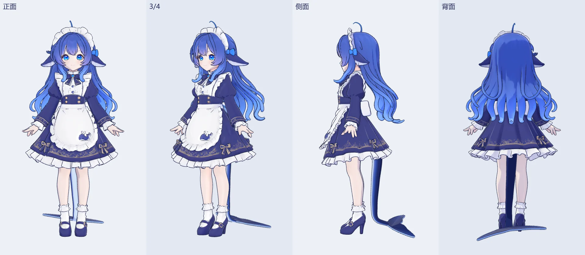
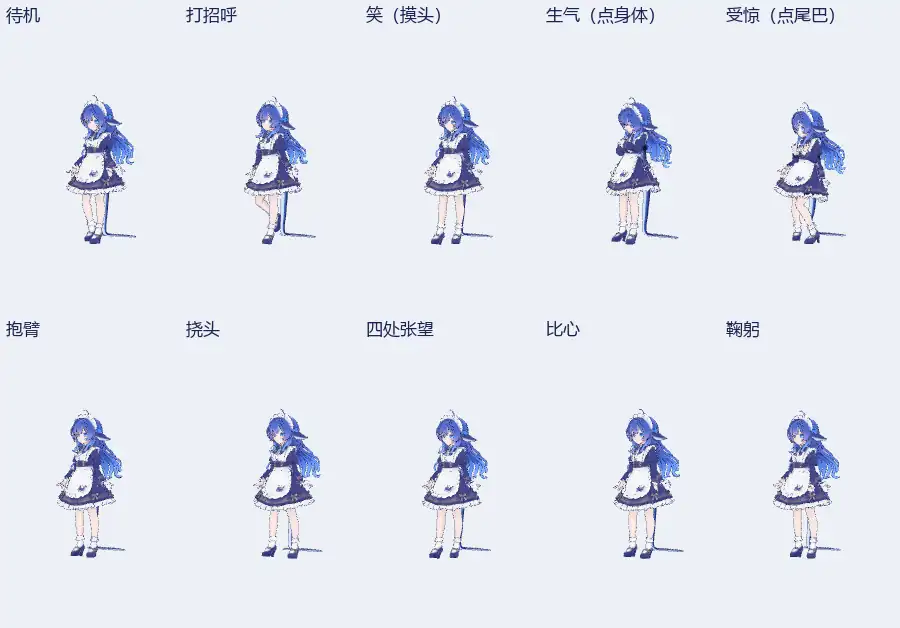
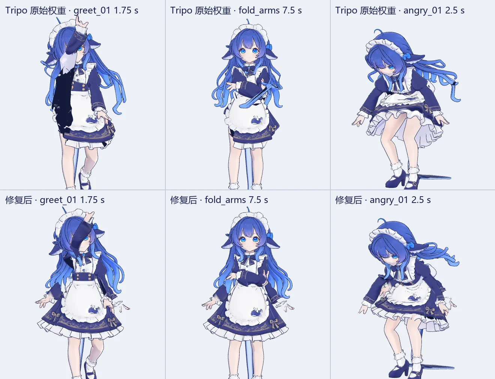

# DeepSeek 鲸鱼娘 3D 形象（开发中）

DeepSeek 的拟人化形象「蓝色大肥鱼」（女仆装鲸鱼娘），准备做成工作进程 3D 视图里可以简单互动的角色。代码和资源暂时只放在 `whale/` 目录下，还没有接入场景，插件的构建、发布文件和 `dist/client.js` 都不受影响。`test/whale.test.mjs` 检查这里的绑骨模型和尾巴。



## 进度

- [x] Tripo 输入图：在设计图基础上改成微笑、A 字姿势、手掌张开，去掉尾巴和呆毛圈（`assets/source/tripo_input.png`）
- [x] 身体：Tripo v3.1 图生模型（`assets/whale_body.glb`）
- [x] 尾巴和呆毛：程序生成（`src/tail.js`、`src/ahoge.js`）
- [x] 着色：赛璐璐两色调 + 边缘光 + 描边（`src/toon.js`）
- [x] 绑骨和 10 个预设动作：Tripo 自动绑骨 v1.0，蒙皮权重重新修过（`assets/whale_rigged.glb`）
- [ ] 脸部贴片：程序绘制的大眼睛和嘴，支持眨眼和 ^^、💢、犯困等表情
- [ ] 交互：悬停注视、摸头、点身体生气、点尾巴受惊、双击吃白饭、30 秒无操作犯困
- [ ] 接入场景：模型打包进懒加载的 `dist/client.whale.js`（插件资源路由只提供 svg/png/webp/jpg，不能直接放 .glb）
- [ ] 版权与署名：模型完成后再处理

## 目录

| 路径 | 内容 |
| --- | --- |
| `src/toon.js` | `toonMaterial()`、`outlineMaterial()`、`applyToon(root)`：不依赖场景灯光的两色调着色和反向外壳描边 |
| `src/tail.js` | `createTail()`：鲸尾网格 + 7 节骨骼；`follow(骨骼)` 让尾巴跟随骨盆，`update(t, state)` 每帧驱动摆动、下垂、贴地和拖尾 |
| `src/ahoge.js` | `createAhoge()`：从头顶长出、向前卷的呆毛 |
| `preview/turntable.html` | 多视角预览页，可以按时间点摆出动作，参数写在文件开头的注释里 |
| `preview/cdp.mjs` | 用无头 Edge 渲染预览页并截图 |
| `assets/whale_rigged.glb` | 绑骨模型：41 根骨骼、10 个动作、修过的蒙皮权重，75,585 个三角面，2048² 底色贴图，4.4 MB |
| `assets/whale_body.glb` | Tripo 生成的身体（未绑骨）：75,753 个三角面，4096² 贴图 |
| `assets/landmarks.json` | 在归一化坐标里测得的头顶位置和头发颜色 |
| `assets/source/tripo_input.png` | 生成身体用的输入图 |
| `tools/` | 读取 GLB 和测量用的 Python 小工具（需要 numpy、Pillow） |
| `tools/rig/` | 修蒙皮权重（`fix_weights.py`）、组装绑骨模型（`build_rigged.py`）、评估变形（`collect_mats.mjs`、`eval_skin.py`） |
| `tripo/client.mjs` | Tripo v3 API 客户端 |
| `tripo/rig.mjs`、`tripo/anims.mjs` | 调用 Tripo 绑骨和动作重定向，结果下载到 `tripo/raw/` |
| `docs/` | 渲染图和动作预览动图 |

## 动作



都是原地动作（Tripo 的 `animate_in_place`），角色不会离开原位。

| 动作 | 时长 | 计划用途 |
| --- | --- | --- |
| `idle` | 15.4 s | 待机，循环播放 |
| `greet_01` | 3.5 s | 打招呼 |
| `laugh_01` | 5.6 s | 笑（摸头） |
| `angry_01` | 3.5 s | 生气（点身体） |
| `scared_01` | 3.3 s | 受惊（点尾巴） |
| `fold_arms` | 17.1 s | 抱臂（傲娇） |
| `scratch` | 13.8 s | 挠头 |
| `look_around` | 15.6 s | 四处张望 |
| `heart_pose` | 5.4 s | 比心 |
| `bow` | 6.0 s | 鞠躬 |

没有做跑、跳、坐：头发和裙子没有物理模拟，不会随动作飘动，做这些动作会穿模。

### 实时播放

尾巴和呆毛不在 GLB 里，加载方法和 `preview/turntable.html` 相同：身体绕 Y 轴旋转 −90°，缩放到身高 1.35 m，尾巴 `follow` 骨骼 `Pelvis`，呆毛挂到骨骼 `Head` 上。每帧先推进动画，再更新尾巴：

```js
tail.follow(pelvis, { floor: 0 }); // 加载后调用一次
// 每帧：
mixer.update(dt);
tail.update(time, { dt });
```

`dt` 让尾巴以 0.08 s 的延迟跟上目标姿势，避免尾巴碰地时跳变；不传 `dt` 时每次调用互相独立，适合按任意时间点截图。其他参数：`sway`、`swing`、`speed` 控制摆动，`curl` 让尾鳍上翘，`hang`（默认 0.8）是抵消骨盆倾斜的比例（0 表示跟着骨盆刚性转动），`floor` 是地面高度（世界坐标）。

## 蒙皮权重

Tripo v1.0 自动绑骨的权重在大动作里变形严重。A 字姿势里手垂在裙子旁边，长发和裙摆两侧被分给了手臂；裙子整块跟着大腿扭转骨转。`tools/rig/fix_weights.py` 先把顶点分成头、头发、躯干、手臂、手、腿、裙子几部分，再按部位重新分配权重：

- 头发跟着头和上身；裙子上沿跟着腰，越往下越多地跟着大腿；手臂的权重只留在同侧躯干上。
- 切开 1,027 个把手臂或手和裙子、头发、躯干连在一起的三角形，`build_rigged.py` 再把切口两侧分别补上（859 个三角形）。
- 部位交界处的权重做平滑过渡。

下表是 10 个动作每 0.25 s 采样一次的结果，箭头左边是 Tripo 原始权重，右边是修复后。模型共 75,585 个三角形，「变形三角形」指至少有一条边被拉长到 1.35 倍以上或压缩到 0.7 倍以下。

| 动作 | 变形三角形（平均） | 变形三角形（最差一帧） | 最大拉伸倍数 |
| --- | --- | --- | --- |
| `greet_01` | 7,248 → 1,131 | 18,113 → 2,873 | 36.8 → 11.0 |
| `idle` | 1,478 → 249 | 2,118 → 489 | 8.8 → 2.8 |
| `angry_01` | 17,058 → 2,646 | 23,285 → 4,428 | 45.5 → 10.6 |
| `fold_arms` | 16,087 → 1,346 | 20,091 → 1,786 | 35.3 → 14.0 |
| `laugh_01` | 9,766 → 3,629 | 17,194 → 12,291 | 32.7 → 12.1 |
| `scared_01` | 15,202 → 3,523 | 16,421 → 5,144 | 44.7 → 7.7 |
| `scratch` | 11,383 → 3,286 | 22,532 → 14,036 | 42.2 → 17.5 |
| `bow` | 2,909 → 1,382 | 5,166 → 5,358 | 23.6 → 5.1 |
| `heart_pose` | 15,799 → 3,466 | 26,150 → 6,086 | 32.6 → 10.4 |
| `look_around` | 3,243 → 1,190 | 5,604 → 4,483 | 17.1 → 6.5 |



还没解决的问题：

- 抬腿时裙子跟着腿走，`laugh_01` 和 `scratch` 最明显，最差一帧仍有 1.2 万到 1.4 万个变形三角形。
- `scared_01`、`look_around`、`laugh_01`、`scratch` 里长发有 2,000 到 4,000 个三角形被拉伸。
- 表里的最大拉伸倍数来自胸口（`Spine02` 附近）和左腋下的少数三角形。

## 预览

1. 在仓库根目录运行 `pnpm install`（预览页用的是 devDependencies 里的 three）。
2. 在仓库根目录启动静态文件服务，例如 `python -m http.server 8000`。
3. 打开预览页：
   - 未绑骨的身体：<http://localhost:8000/whale/preview/turntable.html?glb=../assets/whale_body.glb&tail=1&mode=toon&vib=0.8&crown=-0.0026,1.3265,0.0058&ac0=%23545f96&ac1=%236a91cc>
   - 绑骨模型，`greet_01` 第 1.75 秒：<http://localhost:8000/whale/preview/turntable.html?glb=../assets/whale_rigged.glb&tail=1&mode=toon&vib=0.8&crown=-0.0026,1.3265,0.0058&ac0=%23545f96&ac1=%236a91cc&anim=greet_01&at=1.75>

无头渲染（Windows，需要 Edge），图片保存在 `whale/preview/out/`（不提交）。第二条命令把 `greet_01` 的三个时间点画在一张图里：

```
node whale/preview/cdp.mjs body.png "glb=../assets/whale_body.glb&tail=1&mode=toon&vib=0.8&crown=-0.0026,1.3265,0.0058&ac0=%23545f96&ac1=%236a91cc"
node whale/preview/cdp.mjs greet.png "glb=../assets/whale_rigged.glb&tail=1&mode=toon&vib=0.8&crown=-0.0026,1.3265,0.0058&ac0=%23545f96&ac1=%236a91cc&anim=greet_01&views=34&times=0.9,1.75,2.6"
```

## 重新生成绑骨模型

需要 Tripo 密钥（见「Tripo 生成参数」）和带 numpy、Pillow 的 Python。下载文件和中间结果都在不提交的目录里。

```
node whale/tripo/rig.mjs --yes
node whale/tripo/anims.mjs --yes
python whale/tools/rig/fix_weights.py whale/tripo/raw/anim_test_idle_greet.glb whale/preview/out/weights.glb
python whale/tools/rig/build_rigged.py whale/tripo/raw/anim_test_idle_greet.glb whale/preview/out/weights.glb whale/assets/whale_rigged.glb 2048 whale/tripo/raw/anim_anim2.glb whale/tripo/raw/anim_anim3.glb
node whale/tools/rig/collect_mats.mjs whale/preview/out/mats.json
python whale/tools/rig/eval_skin.py whale/tripo/raw/anim_test_idle_greet.glb whale/assets/whale_rigged.glb whale/preview/out/mats.json
```

- `rig.mjs` 绑骨并做 `idle`、`greet_01`（45 积分），`anims.mjs` 做其余 8 个动作（80 积分）。任务 ID 记在 `tripo/rig_state.json`（不提交），中断后重新运行会继续等原来的任务。状态文件里没有的任务，只有加了 `--yes` 才会新建，因为新建任务要扣积分。绑骨的输入是下面的身体任务，需要用同一个 Tripo 账号。
- `fix_weights.py` 不带额外参数时，用的就是上表那组参数。
- 最后两步在无头 Edge 里每 0.25 s 采样一次每个动作的蒙皮矩阵，再逐个动作对比 Tripo 原始权重和新模型，结果打印出来并写到 `whale/preview/out/mats_eval.json`。

## 设计说明

- 坐标：身体加载后绕 Y 轴旋转 −90°（Tripo 模型朝 +x），等比缩放到身高 1.35 m，脚底在 y = 0，正面朝 +z，单位是米。尾巴和呆毛都用这个坐标系。
- 绑骨模型沿用 Tripo 的 41 根骨骼和骨骼名（`Pelvis`、`Head`、`L_Upperarm` 等），只换了蒙皮权重。贴图只保留 2048² 的底色，法线等其他贴图在赛璐璐着色下用不到。
- 尾巴不交给 Tripo 生成：尾巴藏在双腿后面，Tripo 会把它和腿粘成一块，自动绑骨也没有尾巴骨骼。形状按参考视频：细长的深蓝色尾巴从裙子后摆下面伸出，贴着腿后面垂到地面附近，末端是水平的尾鳍，两端从脚踝两侧露出来。
- 呆毛也是程序生成的：输入图里的呆毛圈被 Tripo 做成了后脑勺上的两块实心圆片，所以先在输入图里把它抹掉了。
- 着色不依赖场景灯光，因为主场景主要靠环境贴图照明。Tripo 贴图里的头发偏灰，`vib` 只给偏蓝的颜色加饱和度，皮肤和白色不受影响。

## Tripo 生成参数

身体（图生模型任务 `4c4a9e9d-4afb-4042-a36e-eebcae7f9214`）：`model v3.1-20260211`、`texture_quality detailed`、`texture_version v3.5-20260815`、`delight true`、`geometry_quality detailed`、`face_limit 80000`、`orientation align_image`、`texture_alignment original_image`、`pbr true`、`model_seed 15233`、`texture_seed 15233`。

绑骨（任务 `c3b0e93f-aa24-4d75-abbd-43bda5889690`）：`model v1.0-20240301`、`rig_type biped`、`spec tripo`、`out_format glb`。选 v1.0 是因为它有 100 多个预设动作；v3.0 的蒙皮更好，但只有走、跑、跳等 11 个动作，没有生气、抱臂、比心这类交互要用的动作。

动作重定向（`animate_in_place true`，每个任务最多 5 个动作）：`6d2d88e2-e2ca-492a-8b92-fce79f80d25d`（`idle`、`greet_01`），`06420656-964a-47cd-bf99-fea564623900`（`laugh_01`、`angry_01`、`scared_01`、`fold_arms`、`scratch`），`d4c4df2c-b116-47b9-8e92-16c5c845bc15`（`look_around`、`heart_pose`、`bow`）。绑骨 25 积分，动作每个 10 积分，共 125 积分。

API 密钥不在仓库里：`tripo/client.mjs` 从环境变量 `TRIPO_KEY_FILE` 指向的文件或 `~/.tripo/api_key.txt` 读取。任务日志 `tripo/tasks.json`、状态文件 `tripo/rig_state.json` 和下载目录 `tripo/raw/` 已加入 `.gitignore`。

## 角色来源

形象的基础是上善无形的原创角色「溟月」（蓝色渐变长发、呆毛、鲸类头鳍、蓝眼睛、鲸尾），之后 B 站 ZipZipPipe 加入了 DeepSeek 元素和深蓝白女仆装。署名和使用许可在模型完成后确定。
